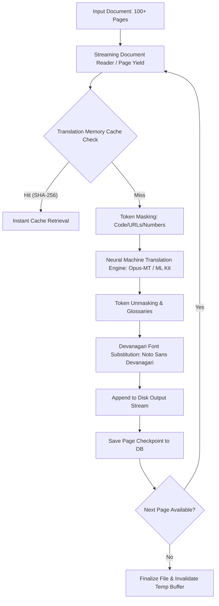
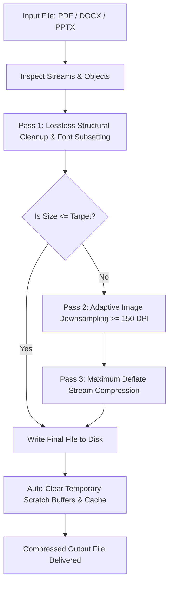

# 2. ARCHITECTURE.md
## Architectural Blueprint & Unlimited-Page Streaming Pipeline

---

### 1. High-Level System Architecture

DocTranslate is split into two completely isolated native applications sharing common conceptual domains:

```
                      +---------------------------------------+
                      |               DocTranslate            |
                      +---------------------------------------+
                                     /         \
                                    /           \
               +-----------------------+     +-----------------------+
               |      windows-app/     |     |      android-app/     |
               | (Python 3.11/PySide6) |     |  (Kotlin/M3 Compose)  |
               +-----------------------+     +-----------------------+
               | - PyMuPDF / docx      |     | - Apache POI / Native |
               | - CTranslate2 Engine  |     | - Google ML Kit NMT   |
               | - SQLite TM & Gloss   |     | - Room DB & WorkMgr   |
               | - Inno Setup (.exe)   |     | - Gradle Signed APK   |
               +-----------------------+     +-----------------------+
```

---

### 2. Unlimited-Page Streaming & Zero-OOM Pipeline

Standard document processing crashes on multi-page files by loading the full AST / DOM into RAM. DocTranslate prevents Out-Of-Memory (OOM) via a **bounded streaming generator pipeline**:



#### Key Elements:
1. **Windowed Memory Consumption**: Only 1 page (or 10 paragraphs) resides in memory at any instant.
2. **Deterministic Garbage Collection**: Processed page handles are dereferenced and closed immediately.
3. **Crash Resilience & Checkpoints**: In case of application termination, the database retains the last translated page index and file segment.

---

### 3. Integrated Format Converter Architecture

The format converter operates in two paths:
1. **Pass-Through Conversion** (`Convert Only`):
   - Example: DOCX to PDF or Markdown to HTML/DOCX.
   - Converts the document layout directly without routing through the NMT pipeline.
2. **Translate & Convert** (`Translate + Transcode`):
   - Ingestion: Extract text runs and geometries using format reader `IRunnableSource`.
   - Transformation: Translate English ↔ Hindi runs.
   - Emission: Write the translated runs using the target format writer `IRunnableTarget`.

---

### 4. Smart File Compressor Architecture

The compression pipeline achieves aggressive size reduction while guaranteeing text readability:



1. **Font Subsetting**: Removes unreferenced glyphs from embedded TTF/OTF fonts, keeping only the exact character set utilized by the document (retaining complete Devanagari conjuncts).
2. **Readability Floor**: Downsampling algorithms enforce a minimum resolution floor (150 DPI) to prevent degradation of embedded receipts, charts, or text diagrams.
3. **Scratch Buffer Wiper**: Implements automatic cleanup (`try ... finally wipe_temp_buffers()`) to ensure no lingering disk clutter remains on the device.

---

### 5. Language Engine Abstraction Layer

Both apps implement a strict translation engine interface:

```
+--------------------------------------------------------------+
|                   ITranslationEngine                         |
+--------------------------------------------------------------+
| + translate_text(text: String, src: Lang, tgt: Lang): String |
| + translate_batch(texts: List<String>, ...): List<String>    |
| + is_model_downloaded(lang: Lang): Boolean                   |
| + download_model(lang: Lang, onProgress: Callback): Void     |
+--------------------------------------------------------------+
```
On Windows: Implemented by `CTranslate2Engine` (Helsinki Opus-MT / IndicTrans2).
On Android: Implemented by `MLKitTranslationEngine` (`TranslateClient`).
