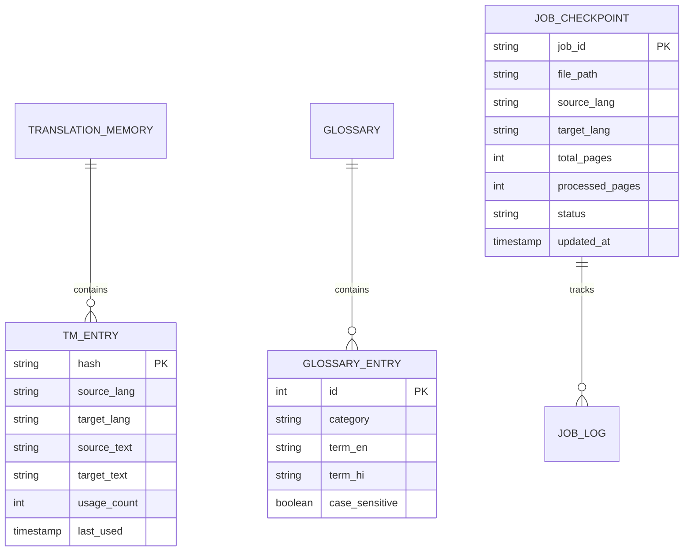

# 3. DATABASE.md
## Database Schemas & Storage Design (SQLite & Room DB)

---

### 1. Storage Strategy
DocTranslate uses embedded, zero-maintenance local databases:
- **Windows Desktop**: Local SQLite 3 database stored at `%APPDATA%\DocTranslate\doctranslate.db`.
- **Android App**: Room Persistence Library database stored in app internal storage (`doctranslate_room.db`).

---

### 2. Entity-Relationship Model



---

### 3. Windows SQLite DDL Specification

```sql
-- Translation Memory Table (Fast sentence deduplication)
CREATE TABLE IF NOT EXISTS translation_memory (
    source_hash TEXT PRIMARY KEY,
    src_lang TEXT NOT NULL,
    tgt_lang TEXT NOT NULL,
    source_text TEXT NOT NULL,
    translated_text TEXT NOT NULL,
    usage_count INTEGER DEFAULT 1,
    created_at DATETIME DEFAULT CURRENT_TIMESTAMP,
    last_used DATETIME DEFAULT CURRENT_TIMESTAMP
);

CREATE INDEX IF NOT EXISTS idx_tm_hash ON translation_memory(source_hash, src_lang, tgt_lang);

-- Custom Glossary Table
CREATE TABLE IF NOT EXISTS glossary (
    id INTEGER PRIMARY KEY AUTOINCREMENT,
    category TEXT DEFAULT 'general',
    term_en TEXT NOT NULL,
    term_hi TEXT NOT NULL,
    case_sensitive INTEGER DEFAULT 0,
    UNIQUE(term_en, term_hi)
);

-- Streaming Checkpoints for Unlimited Pages
CREATE TABLE IF NOT EXISTS job_checkpoints (
    job_id TEXT PRIMARY KEY,
    source_path TEXT NOT NULL,
    target_path TEXT NOT NULL,
    source_format TEXT NOT NULL,
    target_format TEXT NOT NULL,
    total_pages INTEGER NOT NULL,
    completed_pages INTEGER DEFAULT 0,
    status TEXT CHECK(status IN ('pending', 'running', 'paused', 'completed', 'failed')),
    error_message TEXT,
    updated_at DATETIME DEFAULT CURRENT_TIMESTAMP
);
```

---

### 4. Android Room Database Entities (Kotlin)

```kotlin
@Entity(tableName = "translation_memory", primaryKeys = ["sourceHash", "srcLang", "tgtLang"])
data class TranslationMemoryEntity(
    val sourceHash: String,
    val srcLang: String,
    val tgtLang: String,
    val sourceText: String,
    val translatedText: String,
    val usageCount: Int = 1,
    val lastUsedTimestamp: Long = System.currentTimeMillis()
)

@Entity(tableName = "glossary_entries")
data class GlossaryEntity(
    @PrimaryKey(autoGenerate = true) val id: Long = 0,
    val category: String = "general",
    val termEn: String,
    val termHi: String,
    val isCaseSensitive: Boolean = false
)

@Entity(tableName = "job_checkpoints")
data class JobCheckpointEntity(
    @PrimaryKey val jobId: String,
    val sourceUri: String,
    val targetUri: String,
    val totalPages: Int,
    val completedPages: Int,
    val status: String,
    val updatedAt: Long = System.currentTimeMillis()
)
```

